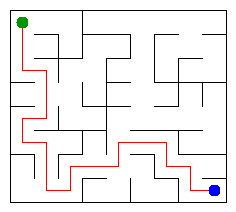

# Assignment 3. Maze Escape

Student ID: 254332

Name: Koishin Bakhtiyar

Group: SE-2540

Maze size (rows x columns): 8 x 9

This file is the report. How to start: `START_HERE.md`. The task: `docs/Assignment3.pdf`.

## Program output

The 13 lines printed on my data by `java -cp out Main`:

    Broken: 71
    Kept: 56
    Last broken wall: 96
    MST cost: 21998
    Heaviest broken wall: 738
    Path length: 21
    DFS visited: 64
    Dead ends: 23
    Zones: 9
    Largest zone: 15
    Is DAG: 0
    Flow stages: 6
    Fastest route cost: 22

My maze:

## Questions

**Mission 0. What do find and union do, and what makes them fast in your code?**

`find` returns the root that represents a cell's group, while `union` merges two different groups and returns `false` if they were already together. Path compression shortens the routes to the roots, and union by size keeps the trees shallow.

**Mission 1. Why is Broken always R*C - 1, and Kept always (R-1)*(C-1)?**

There are `R*C` cells, and each successful union adds one passage without making a cycle, so connecting them all takes exactly `R*C - 1` broken walls. The grid starts with `R*(C-1) + C*(R-1)` inner walls; subtracting the broken ones leaves `(R-1)*(C-1)` kept walls.

**Mission 2. My MST cost from Kruskal and from Prim, and why they are equal:**

Kruskal gives **21998**, and Prim gives **21998** on my walls. Each algorithm connects all cells using a minimum total cost, so both produce an MST of the same weighted grid; the wall costs are distinct here.

**Mission 3. Why is there exactly one path between two cells? How did you avoid a stack overflow on a huge maze?**

The broken walls make a connected graph without cycles, which is a tree, and a tree has exactly one simple path between any two cells. My DFS stores the cells to explore in an explicit stack instead of calling itself recursively, so a long path does not exhaust the Java call stack.

**Mission 4. Why does the second pass of Kosaraju go on the reversed graph? Why do the slides have no cycle exactly when Zones equals the number of cells?**

The first pass records finishing order; following the reversed slides in the second pass collects a whole strongly connected zone without crossing into a zone that has not yet been assigned. A directed cycle would put at least two cells in the same zone, since these input files have no self-slides; therefore the graph is a DAG exactly when every cell is its own zone.

**Mission 5. Why is it enough to go through the zones in the order of their numbers? What does this pass cost?**

Kosaraju numbers the zones in topological order, so every edge between zones goes from a smaller number to a larger one. By the time I process a zone, all earlier zones have already contributed to its longest chain and cheapest route; the pass costs `O(z + e)`, where `z` is the number of zones and `e` is the number of interzone slides.

## AI use

I used ChatGPT to review the code, explain DSU, Kosaraju and algorithm complexity, and identify mistakes in the self-union test and the global Flow stages calculation. It also helped draft this README and check the examples, my personal data, the benchmark and a separate zone graph case. If I used any other AI tools, books or websites, I will add them here before submitting.

## Timing (Mission 7)

Milliseconds, five runs for each algorithm and maze size from `java -cp out Bench` (the average is rounded):

| maze | Kruskal | Prim |
|---|---:|---:|
| 100 x 100 | 29, 11, 19, 28, 21 (avg 22 ms) | 34, 8, 9, 7, 7 (avg 13 ms) |
| 300 x 300 | 162, 102, 70, 50, 63 (avg 89 ms) | 119, 157, 76, 74, 82 (avg 102 ms) |
| 1000 x 1000 | 1351, 1573, 1419, 1230, 1625 (avg 1439 ms) | 2876, 2157, 2270, 2147, 2467 (avg 2384 ms) |

Both algorithms take more time as the grid grows because they must process more walls. The 1000 x 1000 grid has 100 times as many cells as the 100 x 100 grid, and both measured times grow substantially; individual runs vary because of JVM warmup and system load.

## Complexity

`n` is the number of cells, `m` the number of walls or slides, `z` the number of zones, and `e` the number of interzone slides. Bounds include the data structures built by each algorithm.

| algorithm | time | space | assumptions |
|---|---|---|---|
| DSU find and union | `O(alpha(n))` amortized per operation | `O(n)` | Path compression and union by size; initial construction takes `O(n)` |
| Kruskal | `O(m log m + m alpha(n))` | `O(n + m)` | Sorts the walls and uses DSU |
| Prim | `O(m log m)` | `O(n + m)` | Lazy priority queue can hold up to `O(m)` edges |
| DFS | `O(n + m)` | `O(n + m)` | Builds open-neighbour lists and uses an explicit stack; for this maze `m = O(n)` |
| Kosaraju | `O(n + m)` | `O(n + m)` | Two iterative DFS passes, including forward and reversed slide lists |
| Route in the zone graph | `O(m + z + e)` | `O(z + e)` | Build edges from slides, then one topological pass; `e <= m` |

## Before you submit

- [x] `data/walls.txt`, `data/slides.txt` and `output/maze.png` are in the project.
- [x] `java tools/Check.java` reports that all examples and DSU checks pass.
- [x] This README contains the program output and the AI use section.
- [ ] Push the changes to `main` and check the required history: the uploaded archive had only three commits, while the task asks for at least one meaningful commit per mission (at least seven).
- [ ] Verify that the repository is public and attach its link in Moodle.